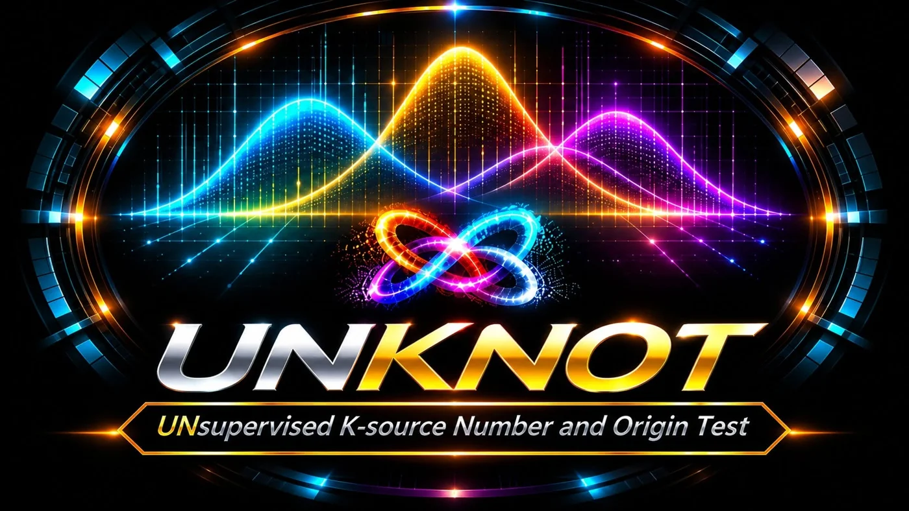

<p align="center"></p>

# UNKNOT mk1 — bottom line

**UNsupervised K-source Number and Origin Test.** A plain-language deck on the first full UNKNOT run: is the ATLAS Run-3 muon-spectrometer vertex background one distribution, or several mixed together?

> **Internal, exploratory.** mk1 results on background data only (`DataHTMissLow`, 36,059 vertices, runs of 10–11 Nov 2026). Numbers are preliminary and not an ATLAS result.

## View it

- **In the browser:** open `index.html` (or the GitHub Pages site for this repo). Arrow keys or ◀ ▶ to move, `N` for speaker notes, click the bar strip to jump to a slide.
- **Download** (buttons in the deck's top-right corner, or straight from [`downloads/`](downloads/)):

| Format | File | Notes |
|---|---|---|
| HTML | [`UNKNOT_mk1_bottom_line.html`](downloads/UNKNOT_mk1_bottom_line.html) | One self-contained file, works offline; speaker notes included (`N`) |
| PDF | [`UNKNOT_mk1_bottom_line.pdf`](downloads/UNKNOT_mk1_bottom_line.pdf) | 23 pages, printed from the HTML deck |
| PPTX | [`UNKNOT_mk1_bottom_line.pptx`](downloads/UNKNOT_mk1_bottom_line.pptx) | Editable PowerPoint: native text and charts, speaker notes on every slide |

## Slides

| # | Title |
|---|---|
| 01 | Is our background one distribution, or several mixed together? (cover) |
| 02 | How this was built: a “double-blind” outline |
| 03 | Who does what: overlaps and gaps |
| 04 | What the blind test shows |
| 05 | The bottom line, before any detail |
| 06 | How UNKNOT works, in four steps |
| 07 | One candidate in the barrel; the rest are hints |
| 08 | Endcap: a candidate that dissolved |
| 09 | Barrel: the one candidate that holds, so far |
| 10 | Every way we searched, by category |
| 11 | What an extra background would flag as |
| 12 | The statistics behind the four ways |
| 13 | Most of what we see is not the particle we are looking for |
| 14 | We only believe a count when independent judges agree |
| 15 | The trap: a smooth trend can pretend to be two groups |
| 16 | Endcap: account for activity, and the separate groups vanish |
| 17 | Barrel: two groups survive every check |
| 18 | Direction gives the clearest fingerprints (barrel) |
| 19 | Collision debris leaves a clue in the missing momentum |
| 20 | Mixing groups can fake the link our method forbids |
| 21 | A side finding: one endcap score is reacting to a placeholder |
| 22 | What we can't say yet, and what comes next |
| 23 | Untangled so far: one knot was a trend, one still holds (close) |

## Bottom line

- **Endcap:** one background whose shape moves smoothly with detector activity; the apparent groups dissolve once activity is held fixed.
- **Barrel:** one candidate second group (56% of barrel vertices, 3% of all) that passes every count check run so far; origin open.
- The rest are hints of the three expected sources (collision debris, beam halo, cosmic rays), not new groups.

## Repo layout

```
index.html          the deck (player + download buttons)
downloads/          HTML · PDF · PPTX
assets/             favicon and logo
.nojekyll           serve files as-is on GitHub Pages
```

## References

- L. Bruce, “Rank-K ABCD in pictures”, internal, 23 Oct 2026.
- ATLAS Collaboration, *Search for massive, long-lived particles in events with displaced vertices and displaced muons in pp collisions at √s = 13.6 TeV*, Phys. Lett. B 878 (2026) 140509.

Part of the [ATLAS presentations](https://n-herling-mk1.github.io/ATLAS_presentations_/) collection · Nathan Herling · UA ATLAS HEP Group
